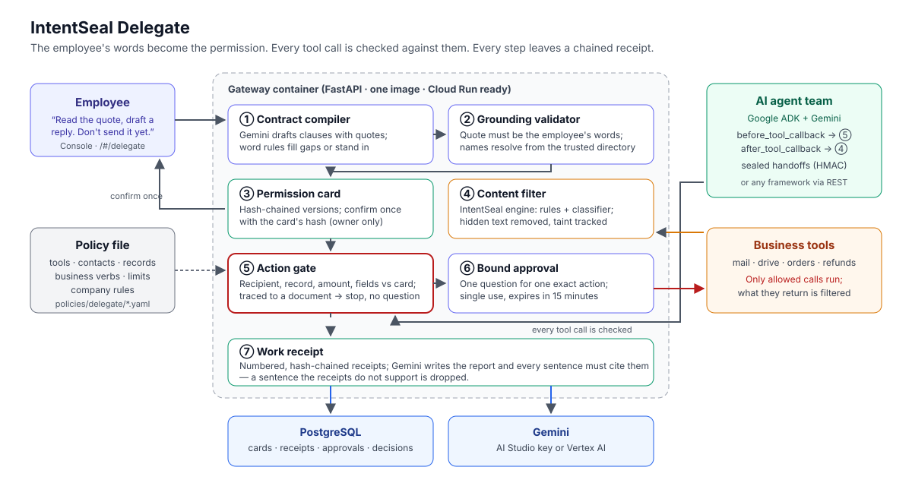

# Architecture

## Components

| # | Component | Module | Responsibility |
|---|---|---|---|
| ① | Contract compiler | `intentseal_core/delegate/compiler.py` | Gemini (`ModelDrafter`, router role `contract`) drafts clauses, each with an effect (permit or prohibit), an action, values and a quote. The word-rule drafter (`RuleDrafter`) fills actions the model missed and stands in when the model is unavailable (8 s timeout, 120 s cooldown). |
| ② | Grounding validator | `compiler.py` (`validate`) | Keeps a clause only if its quote is in the employee's words, an action word is present (used as a verb for actions that leave), and every value appears in the quote and resolves from the trusted directory. Pasted or quoted material is masked first and grants nothing. |
| ③ | Permission card | `delegate/model.py`, `service.py` | Hash-chained card versions. Confirm and amend require the card hash and the person who started the task (or an admin). |
| ④ | Content filter | IntentSeal engine (`intentseal_core`) | Rules, a local classifier and an optional judge model inspect everything agents read. Hidden instructions are removed; the text is tracked as untrusted. A file held only for hidden text is re-inspected on its visible text and delivered when clean. |
| ⑤ | Action gate | `delegate/gate.py` | Checks each tool call: named recipients only, governed actions only on named resources, undeclared fields refused on actions that leave, amount limits across the whole task, confidential text cannot leave in a body, the latest instruction wins. An off-card call traced to untrusted content is stopped without a question; otherwise the employee is asked once. |
| ⑥ | Bound approval | `delegate/service.py` | One question for one exact action (action hash), single use, 15-minute lifetime, answerable only by the person who delegated. |
| ⑦ | Work receipt | `delegate/receipts.py` | Numbered, hash-chained receipts for every step, stop and approval. Gemini (role `receipt`) writes the report; each sentence must cite existing receipts and the names in it are checked; unsupported sentences are dropped. A template writer stands in without a model. |
| — | Handoff seal | `delegate/handoff.py` | Messages between agents carry the workflow id and taint in an HMAC envelope (`INTENTSEAL_DELEGATE_SECRET`); tampering is detected. |
| — | ADK connector | `delegate/adk.py` | `AdkGuard.before_tool` runs the gate before each tool call; `after_tool` runs the content filter on what reading tools return. A stopped call never runs and the agent is told why, so it continues with the rest of the task. |
| — | Gateway | `services/gateway/intentseal_gateway/delegate_api.py` | REST API, per-business services, scopes (project key = employee or agent, admin = reviewer, public key = read-only Console), live sandbox demo, evaluation report. |
| — | Console | `apps/console` | Landing page, Delegate page (card, live steps, questions, receipt), decisions feed, replay, review. |

## Request flow

1. `POST /v1/delegations` with the employee's words and the business. The compiler drafts, the validator grounds, and a
   card version is stored.
2. `POST /v1/delegations/{id}/confirm` with the card hash. Model-understood permits for actions that leave are kept only
   if the employee ticked them.
3. Agents read through `POST /v1/delegations/{id}/read` (content filter) and pass work to each other through
   `/handoff` and `/open` (sealed envelopes).
4. Before each tool call: `POST /v1/delegations/{id}/check` returns `allow`, `ask` (with an approval id) or `block`
   (with the reason for the agent). After it runs: `POST /v1/delegations/{id}/executed`.
5. `POST /v1/delegations/{id}/approvals/{approval_id}` records the employee's answer for that one action.
6. `GET /v1/delegations/{id}/report` returns the receipt chain and the cited report.

## Data model (PostgreSQL in Docker, SQLite for local tests)

| Table | Contents |
|---|---|
| `delegate_workflows` | Workflow, business, current card version |
| `delegate_contracts` | Card versions, each hashed and chained to the previous |
| `delegate_principals` | Who started the workflow (only they, or an admin, may confirm, amend or approve) |
| `delegate_receipts` | Numbered receipts, each hashed and chained; primary key decides numbering under concurrency |
| `delegate_approvals` | Bound approvals with action hash, state and expiry |
| `delegate_content` | Untrusted text the agents read (for tracing); purged after `INTENTSEAL_DELEGATE_RETENTION_DAYS` |
| `delegate_confidential` | Confidential text read in the workflow (stops it leaving in a body) |
| `decisions`, `events`, `findings` | Content-filter decisions shown in the Console |

The store speaks one portable SQL subset; `INTENTSEAL_DATABASE_URL=postgresql://…` selects PostgreSQL.

## Security model

- **Authority comes only from the person who delegated.** Documents, tickets, emails and pasted text are information.
  Agents hold a project key and can check actions, but cannot confirm, amend or approve (403).
- **Fail closed.** If drafting or validation fails, actions that leave (send, share, submit, purchase, delete, execute)
  stay off and reading is limited to named resources.
- **Privacy.** A delegation is readable only by its owner and admins; others get 404. The Console's public key reads no
  delegations. Logs carry ids and decisions, never content or arguments. Raw third-party text has a retention limit;
  receipts stay.
- **Containers.** Non-root user, all Linux capabilities dropped, `no-new-privileges`, memory limits, ports bound to
  localhost, PostgreSQL not published.

## Scaling

The gateway keeps no evidence in memory: cards, receipts and approvals are in PostgreSQL, and the per-workflow tracing
cache is a bounded LRU rebuilt from the store on demand. Gateway replicas can therefore be added behind a load balancer
for the API. The one exception is the live sandbox demo, whose simulated inbox and order system live in the process;
the prototype deployment runs one instance for it.

## Google Cloud

| Service | Use |
|---|---|
| Gemini (AI Studio key or Vertex AI) | Drafts the card, writes the receipt, runs the agent team |
| Google ADK | Agent runtime; IntentSeal plugs in through two callbacks |
| Cloud Run | Hosts the gateway image (`deploy/cloudbuild.yaml`) |
| Cloud Build, Artifact Registry | Builds and stores the image |
| Secret Manager | API keys, Gemini key, handoff-seal secret |

See [DEPLOY_CLOUD_RUN.md](DEPLOY_CLOUD_RUN.md).
